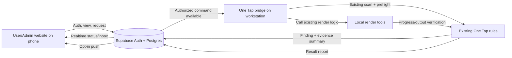

# Architecture Description

## Components

1. **Anything Share website/PWA:** responsive Liquid Glass front end; uses existing Anything Supabase authentication and the anon/publishable key. It stores no secrets or media.
2. **Supabase:** Auth, Postgres tables with RLS, Realtime for live website updates, Edge Functions for privileged validation/notification dispatch and command lifecycle, and a scheduled retention task.
3. **One Tap bridge connector:** small addition to the installed One Tap main process. It calls existing local scanner, preflight, render-start, render-completion, and task-tracker logic. It initiates outbound authenticated Supabase requests or listens to an authorized channel. It does not expose a public local HTTP endpoint.
4. **Local workstation and render tools:** One Tap runs the work against local files and existing configured drives. Supabase never receives media.
5. **Phone push:** Web Push for the installable website. Supabase stores the subscription and notification record; a trusted function dispatches a push. iOS web push requires the user to add the website to Home Screen on a supported iOS/iPadOS version. Native apps would require platform delivery services (FCM/APNs); they are not part of the Supabase-only web MVP.

## Data and command flow

## Trust boundaries

- Website user actions are untrusted until validated by RLS/Edge Function.
- Supabase service-role secret remains only in trusted server-side function configuration; never put it in website or desktop renderer code.
- Bridge uses a dedicated enrolled device identity/short-lived user session, least privilege, and outbound TLS. Never trust a role from a local JSON file, command-line arg, or renderer request as authority.
- Push private keys are server-side only. Push messages contain minimal content.
- Local filesystem paths stay on the workstation. Reports should use a stable opaque item ID and safe evidence summary.

## Status and render protocol

1. Bridge heartbeat and scanner report reach Supabase.
2. Supabase records an immutable report/event and updates the current summary only for a recognized result.
3. Unsupported/contradictory result becomes correction-needed, not a guessed state.
4. Website creates an idempotent render command after an authorized explicit user action.
5. Bridge claims command once; One Tap validates local state. Failed checks return exact reason and pause for Admin action.
6. Passing checks call the existing One Tap render entry point. Bridge sends progress and verified result.
7. Supabase creates completion notification and dispatches push. In-app inbox remains the durable fallback.

## Free-tier design

Store small records only; avoid media/storage, heavy polling, and one Realtime subscription per list row. Use one scoped channel or periodic lightweight heartbeat. Supabase free-tier quotas and pause behavior are provider-controlled and may change. Rendering consumes the workstation's resources, not Supabase compute. Website hosting must use a free static host if a separate host is used; no external free tier is guaranteed forever.

## Existing code versus additions

Existing Anything has Supabase authentication/roles and Windows desktop notifications. Existing One Tap has local task tracking, folder scanning, status rules, render completion reporting, and local status/event records. The remote website, schema additions, bridge enrollment, remote command claim/start operation, evidence reporting, PWA push setup, and retention scheduler are additions. The bridge must call existing functions rather than duplicate their rules.
